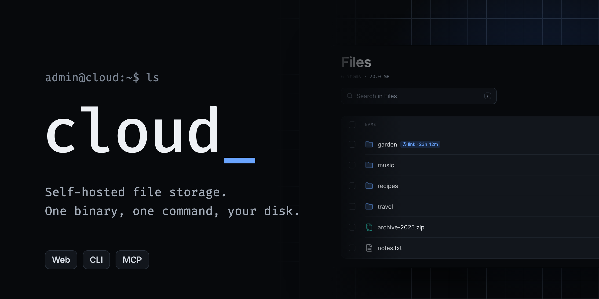
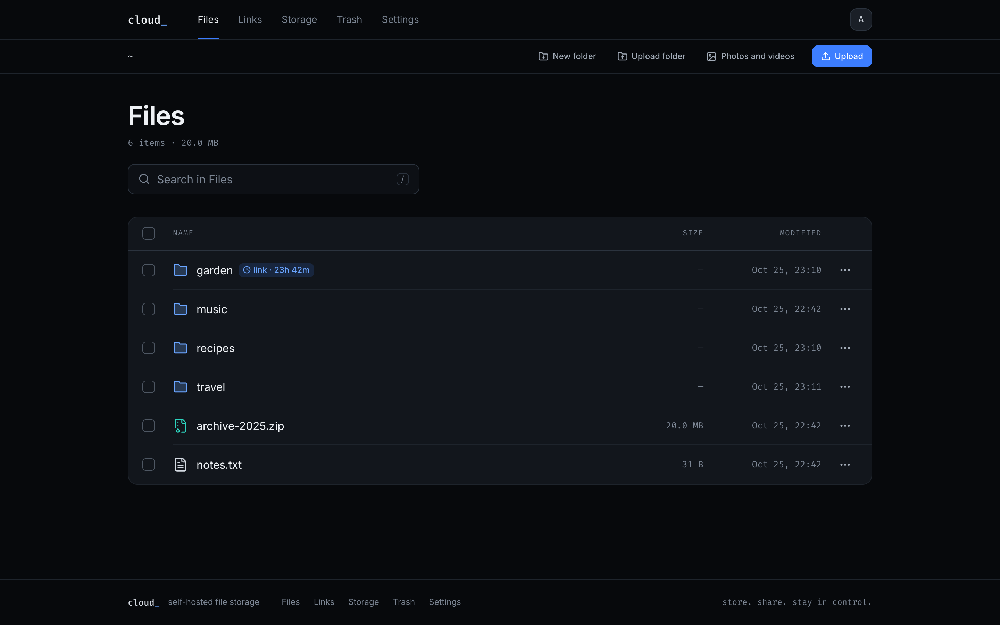
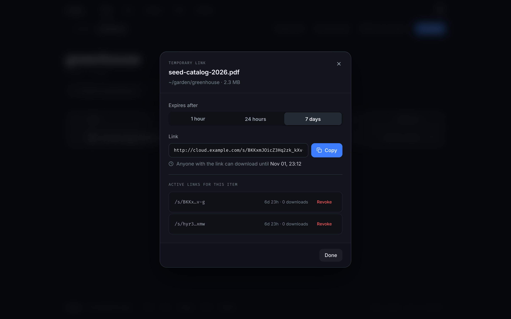
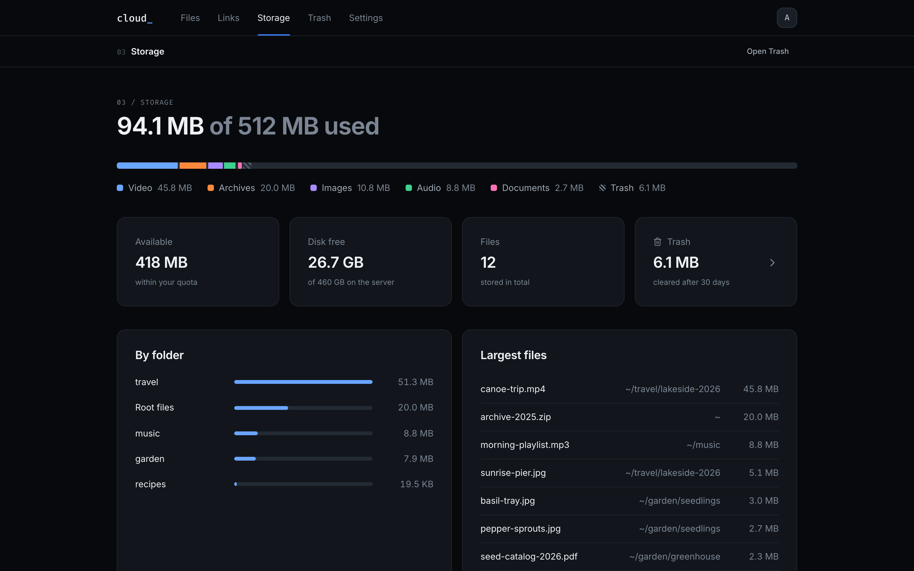
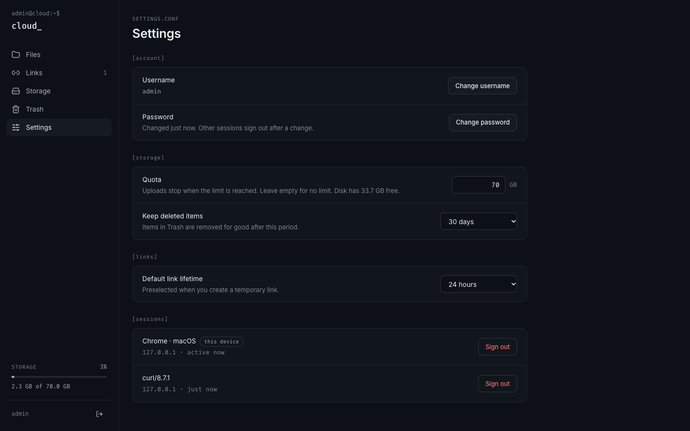
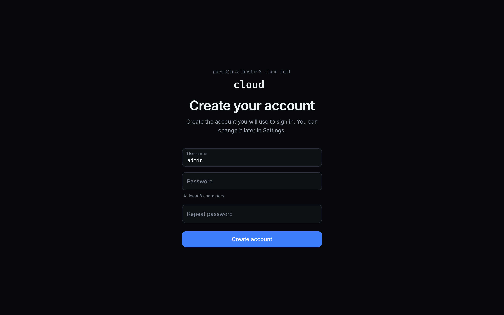
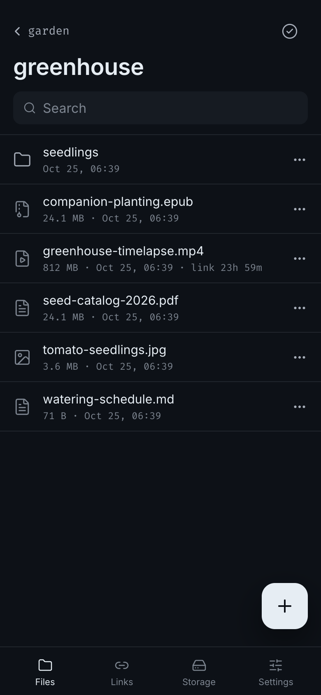
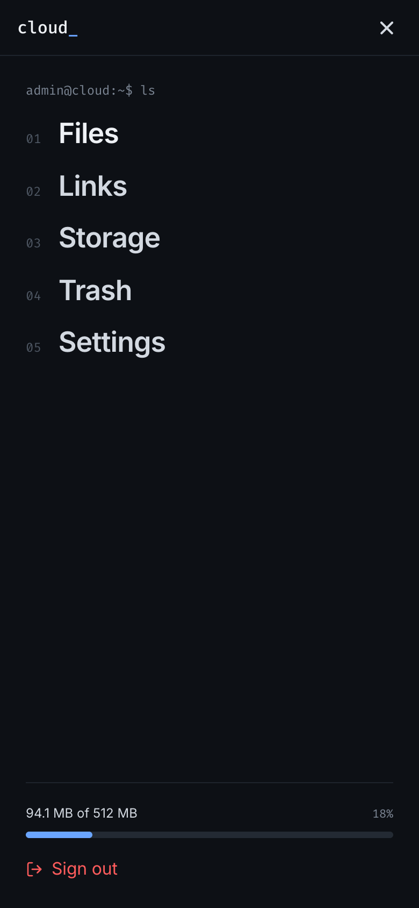
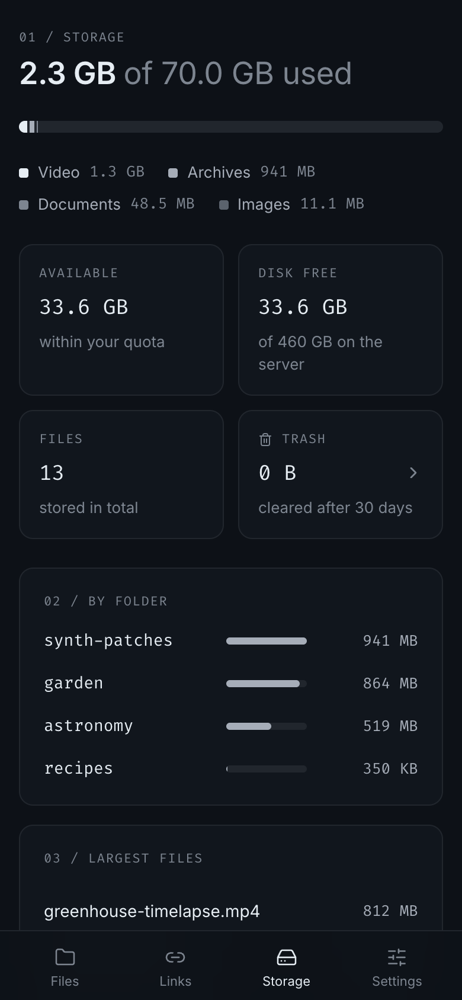

<div align="center">



<br />
<br />


<br />
<br />

</div>


---

### `01 / WHAT IT IS`

A self-hosted control panel for your cloud storage. Manage files and folders from
any browser, automate them from the command line, or connect an AI agent through
MCP. All three use the same HTTP API, accounts and permissions.

Upload large files with resume, share folders, collect files through upload-only
links, recover deleted items and keep track of disk usage. One Go binary, one
container, SQLite and your own disk.

<p align="center">
  
</p>

<table>
  <tr>
    <td width="50%"></td>
    <td width="50%"></td>
  </tr>
  <tr>
    <td></td>
    <td></td>
  </tr>
</table>

<p align="center">
  
  &nbsp;&nbsp;
  
  &nbsp;&nbsp;
  
</p>

### `02 / QUICK START`

Download a native binary for **Linux, macOS or Windows** from
[Releases](https://github.com/din9xtr/cloud-control-panel/releases/latest).
Choose `amd64` for Intel/AMD or `arm64` for ARM/Apple Silicon, extract it and run
`./cloud serve` (`.\cloud.exe serve` in PowerShell). Open `http://localhost:8080`.
The binary includes the web interface, CLI and MCP server.

Or use Docker:

Requirements: Docker with Compose v2.

```bash
git clone https://gitea.din9xtr.tech/din9xtr/cloud-control-panel.git
cd cloud-control-panel
mkdir -p data
docker compose up -d
```

Open `http://localhost:8080` and create your account. Files and the database live in
`./data` next to `docker-compose.yml`, so a backup is a copy of that folder.
The container runs as UID and GID 1000; if your user has other ids, set `CLOUD_UID`
and `CLOUD_GID` in `.env` before the first start.

| Task                       | Command                                                       |
| :------------------------- | :------------------------------------------------------------ |
| Update to the latest code  | `git pull && docker compose up -d --build`                    |
| Follow logs                | `docker compose logs -f cloud`                                |
| Back up                    | `docker compose stop && tar czf cloud-backup.tgz data && docker compose start` |
| Reset a forgotten password | `docker compose exec -it cloud /cloud passwd -username admin` |
| Stop                       | `docker compose down`                                         |

### `03 / WEB, CLI & AGENTS`

- **Web:** open the server address and sign in. File and folder actions live under **⋯**.
- **CLI:** build the same binary with `go build -o cloud ./cmd/cloud`, then run
  `./cloud cli --server https://cloud.example.com login --username owner`.
- **Agent:** start `cloud mcp` from your MCP client with the server URL, CLI session
  and an optional directory for local file transfers.

Start with [connection setup](docs/clients.md). It covers browser access, sessions,
CLI installation and MCP configuration. The [generated command reference](docs/commands.md)
comes from the same contract as the frontend types, CLI commands and MCP tools.

### `04 / DOCUMENTATION`

- [Connection setup](docs/clients.md): start a server and connect web, CLI or an agent
- [Command reference](docs/commands.md): generated names, aliases and arguments
- [CLI](docs/cli.md): remote commands, resumable transfers and terminal examples
- [MCP server](docs/mcp.md): agent tools, stdio configuration and local file access
- [Configuration](docs/configuration.md): environment variables and reverse proxies
- [Architecture](docs/architecture.md): packages and the HTTP contract
- [Security](docs/security.md): how files, sessions and the server are protected
- [Development](docs/development.md): running from source and the checks every change must pass
- [Web interface design](docs/design.md): tokens, typography, layout and motion of the web UI

---

<div align="center">

<samp>[MIT License](LICENSE) · Copyright © 2026 Din9xtr</samp>

</div>
